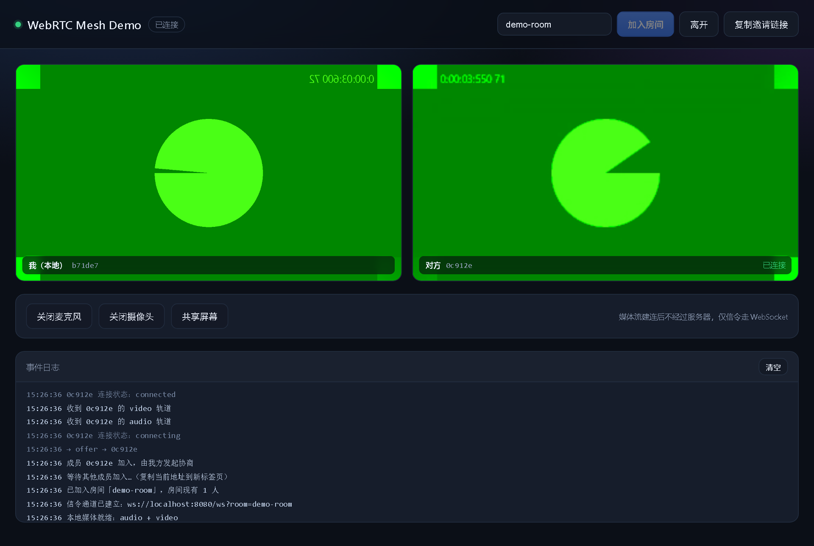

# WebRTC Mesh Demo

本文档汇总了 WebRTC 的基础概念与信令服务器的实现逻辑。仓库内已包含可运行的 Demo：`server.js`（Node.js 信令服务）+ `public/`（浏览器端采集、协商与渲染）。



> 截图由 Chrome 虚拟摄像头（`--use-fake-device-for-media-stream`）生成，两个页面加入同一房间后的实际界面。

## 功能

- 2~4 人 P2P 音视频通话，仅信令经过服务器，媒体直连
- perfect negotiation 处理 offer 冲突（glare），客户端缓存早到的 ICE candidate
- 静音、开关摄像头、屏幕共享（`replaceTrack`，不触发重新协商）、一键复制邀请链接
- 房间人数上限、服务端生成 peerId、心跳清理失联连接、静态资源目录穿越防护
- `npm run smoke` 一条命令覆盖 16 项信令与静态资源断言
- 零构建：原生 ESM + DOM，无前端框架，仅一个运行时依赖 `ws`

技术栈：Node.js ≥ 18（ESM）+ `ws` + 原生 WebRTC / WebSocket API。

## 目录

- [快速开始](#快速开始)
- [测试步骤](#测试步骤)
- [1. WebRTC 是什么](#1-webrtc-是什么)
- [2. 三个核心浏览器 API](#2-三个核心浏览器-api)
- [3. 一次连接的建立流程](#3-一次连接的建立流程)
- [4. 信令服务器的职责边界](#4-信令服务器的职责边界)
- [5. 需要搬运的 4 类消息](#5-需要搬运的-4-类消息)
- [6. 服务端数据结构](#6-服务端数据结构)
- [7. 消息时序](#7-消息时序)
- [8. 最小可用服务端实现](#8-最小可用服务端实现)
- [9. 客户端必须配合的三个关键点](#9-客户端必须配合的三个关键点)
- [10. 生产化必须补齐的事项](#10-生产化必须补齐的事项)
- [11. 一句话总结](#11-一句话总结)

---

## 快速开始

```bash
npm install
npm start
```

1. 浏览器打开 <http://localhost:8080>，点击「加入房间」。
2. 复制顶栏「复制邀请链接」得到的地址，在新标签页打开并点击「加入房间」。
3. 两个页面互通后，本地/远端画面会同时出现，事件日志会显示 `→ offer`、`→ answer` 与 `connected`。

> 必须用 `localhost` 或 HTTPS 打开：`getUserMedia` 要求安全上下文（secure context）。
> 房间最多 4 人（纯 P2P mesh 上限），超出会被服务端以 `4001` 拒绝。

### 文件结构

| 文件 | 说明 |
| --- | --- |
| `server.js` | HTTP 静态资源 + WebSocket 信令：房间管理、SDP / ICE 转发、心跳与清理 |
| `public/index.html` | 页面结构（顶栏、视频卡片、控制按钮、事件日志） |
| `public/app.js` | 采集、PeerConnection、perfect negotiation、静音/关摄像头/屏幕共享 |
| `public/style.css` | 深色主题样式，响应式网格 |
| `scripts/smoke-test.mjs` | 信令服务器冒烟测试（房间、转发、人数上限、静态资源与目录穿越） |
| `docs/screenshot.png` | README 使用的界面截图 |

### 配置（环境变量）

| 变量 | 默认值 | 说明 |
| --- | --- | --- |
| `PORT` | `8080` | HTTP 与 WebSocket 共用端口 |
| `HOST` | `0.0.0.0` | 监听地址。仅本机使用可设为 `127.0.0.1` |

```powershell
$env:PORT=3000; $env:HOST='127.0.0.1'; npm start   # PowerShell
PORT=3000 HOST=127.0.0.1 npm start                  # macOS / Linux
```

### 安全说明

这是一个**教学用 Demo，没有任何鉴权**：

- 房间号即"密码"，知道房间号的人都能加入（最多 4 人）
- 服务端只转发 SDP / ICE，不校验用户身份，也不限制消息频率
- 默认监听 `0.0.0.0` 是为了方便局域网内手机测试；**不要直接把它暴露到公网**
- 需要公网部署时，至少补上：握手鉴权（JWT / Cookie）、TURN 临时凭证、连接与消息限流、HTTPS

### 验证

快速验证只需两步：先 `npm start`，再在另一个终端执行 `npm run smoke`。完整的回归流程见下一节。

## 测试步骤

按以下顺序执行即可完成回归。信令层已脚本化，浏览器层为手动清单。

### 1. 前置条件

- Node.js ≥ 18，且已在项目根目录执行 `npm install`
- 浏览器：Chrome / Edge（Safari 16+、Firefox 亦可）
- 必须通过 `http://localhost` 或 HTTPS 访问，否则 `getUserMedia` 不可用

### 2. 启动服务

```bash
npm start
```

预期输出：`信令服务器已启动：http://localhost:8080`。另开终端确认静态资源可访问：

```powershell
(Invoke-WebRequest -UseBasicParsing http://localhost:8080/).StatusCode   # 期望 200
```

### 3. 信令冒烟测试（自动化）

服务保持运行，另开终端：

```bash
npm run smoke
```

预期 `16/16 通过`。覆盖用例：

| 用例 | 预期 |
| --- | --- |
| `GET /`、`/style.css`、`/app.js` | 200，CSS / JS 的 MIME 正确 |
| `/..%2Fpackage.json` 目录穿越 | 404，且响应体不含仓库文件内容 |
| 两人加入同一房间 | A 收 `joined(peers=[])`；B 收 `joined(peers=[A])`；A 收 `peer-joined(B)` |
| offer / answer / ICE 转发 | 对端收到，`from` 为服务端生成的 id |
| 客户端伪造 `from` | 被服务端覆盖 |
| `to` 指向不存在的人或自己 | 静默丢弃，不产生投递 |
| 第 5 人加入（上限 4） | 关闭码 `4001`，reason `room is full` |
| B 发送 `bye` | A 收到 `peer-left(B)` |

### 4. 手动双端测试（核心）

用两个标签页即可（或一台电脑 + 一台手机，跨设备见第 7 节）。

1. 打开 <http://localhost:8080>，记录房间号（默认随机，如 `room-ab12cd`）
2. 点「加入房间」，允许摄像头/麦克风
3. 点「复制邀请链接」，在新标签页粘贴打开，再点「加入房间」

预期：

| 检查项 | 预期 |
| --- | --- |
| 顶栏状态 | 两个页面都变「已连接」（绿点） |
| 远端卡片 | 出现「对方 + 6 位 id + 已连接」，并显示对方画面 |
| 本地预览 | 有画面且镜像显示，标注「我（本地） + id」 |
| 事件日志 | 老成员侧有 `→ offer`，新成员侧有 `→ answer`，两侧都有 `连接状态：connected` |
| 服务端控制台 | `+ xxxxxx 加入 room-xxx（2 人）` |

> 画面没出来时，先看事件日志是否出现 `收到 xxx 的 video 轨道`。若已有轨道但没画面，点一下远端卡片——浏览器可能拦截了带声音的自动播放。

### 5. 功能用例逐项验证

| # | 操作 | 预期结果 |
| --- | --- | --- |
| 1 | 点「关闭麦克风」 | 按钮变红并显示「开启麦克风」，对端听不到声音 |
| 2 | 再点「开启麦克风」 | 恢复收音 |
| 3 | 点「关闭摄像头」 | 本地预览变占位图，对端画面变「等待对方画面…」 |
| 4 | 点「共享屏幕」 | 弹出选择窗口；选屏后本地预览变为屏幕内容（不再镜像），对端同步看到 |
| 5 | 共享中点「停止共享」 | 恢复摄像头画面；日志中没有新的 offer / answer（`replaceTrack` 不触发重新协商） |
| 6 | 共享中点浏览器自带的「停止共享」 | 同样自动恢复摄像头 |
| 7 | A 点「离开」 | A 回到「未连接」、摄像头灯灭；B 的远端卡片消失，日志出现 `成员 xxx 已离开` |
| 8 | B 再点「加入房间」 | 重新建立连接，画面恢复 |
| 9 | 刷新页面后重新加入 | 正常建连（服务端心跳清理旧连接，可能有 ≤30s 延迟） |
| 10 | 加入一个没人存在的房间号 | 单人也能加入，提示「等待其他成员加入…」 |

### 6. 异常路径

| 场景 | 操作 | 预期 |
| --- | --- | --- |
| 拒绝摄像头权限 | 在地址栏禁用摄像头后加入 | 日志红字「获取摄像头/麦克风失败…」，状态回「未连接」，按钮恢复可点 |
| 房间满 | 4 个标签页加入后开第 5 个 | 第 5 个立即断开，日志提示 `code=4001，room is full` |
| 服务端中途关闭 | 通话中按 `Ctrl+C` 停服务 | 两端数秒内变「已断开」，远端卡片移除，摄像头关闭 |
| 未启动服务 | 不启动服务直接点加入 | 8 秒后提示「连接信令服务器超时」 |
| 跨浏览器 | Chrome 与 Edge 各开一个标签页 | 正常互通（验证 SDP 兼容性） |

### 7. 无摄像头 / 跨设备

没有摄像头时可用 Chrome 虚拟设备（自动化测试也用它）：

```powershell
& "C:\Program Files\Google\Chrome\Application\chrome.exe" `
  --user-data-dir="$env:TEMP\webrtc-fake-profile" `
  --use-fake-device-for-media-stream `
  --use-fake-ui-for-media-stream `
  http://localhost:8080
```

macOS / Linux 下把浏览器路径换成 `/Applications/Google Chrome.app/Contents/MacOS/Google Chrome` 或 `google-chrome`，其余参数相同。

手机访问同一局域网：

```powershell
ipconfig | Select-String "IPv4"     # 查本机 IP，手机访问 http://192.168.x.x:8080
```

⚠️ 手机通过 `http://192.168.x.x:8080` 打开时不是安全上下文，`getUserMedia` 会被拒绝。需要跨设备测试时，用 `mkcert` 生成证书并给 `server.js` 换成 `https.createServer`，或临时用内网穿透工具（ngrok / cloudflared）拿到 HTTPS 域名。

### 8. 判断是否真的 P2P 直连

- 事件日志出现 `connected` 表示 ICE 已连通
- 通话中停掉信令服务，**已建立的音视频仍会继续**（媒体不走服务器），可据此确认是 P2P；重新协商或刷新才会断
- 当前只配置了公共 STUN、没有 TURN，两端处于对称 NAT 等环境时可能连不通

## 1. WebRTC 是什么

**WebRTC（Web Real-Time Communication）是一套让浏览器或客户端直接进行实时音视频和数据通信的开放技术标准。**

它不只是一个 JS API，而是一整套协议栈 + 浏览器内置引擎，核心目标是在无插件的情况下完成点对点（P2P）通信。

关键特征：

- 浏览器原生支持，无需插件
- 低延迟（通常 < 200ms）
- P2P 直连，节省服务器带宽
- 全程强制加密（DTLS-SRTP）

但它**不负责**「找到对方」和「交换连接参数」——这部分由应用层自己实现，也就是信令服务器。

## 2. 三个核心浏览器 API

| API | 作用 |
| --- | --- |
| `getUserMedia()` | 采集摄像头、麦克风、屏幕（`getDisplayMedia`） |
| `RTCPeerConnection()` | 建立连接、协商编解码器、传输音视频流 |
| `RTCDataChannel()` | 传输任意数据（类似 WebSocket，但是 P2P，可配置可靠/不可靠） |

## 3. 一次连接的建立流程

1. **信令（Signaling）**：双方交换 SDP（会话描述，包含编解码器、媒体能力）和 ICE candidate（网络候选地址）。WebRTC 标准**不规定**信令协议，可用 WebSocket、HTTP，甚至手动复制粘贴。
2. **NAT 穿透**：用 **STUN** 获取公网地址；打洞失败时用 **TURN** 服务器中继。
3. **媒体传输**：音视频走 **SRTP**（加密的 RTP），数据通道走 **SCTP over DTLS**。
4. **加密**：强制 DTLS-SRTP，媒体全程加密。采集设备要求 HTTPS 或 localhost 环境。

> 注意：媒体流建立后**不再经过信令服务器**，除非使用了 TURN 中继。

## 4. 信令服务器的职责边界

信令服务器**不处理音视频**，只做一件事：

> 在 P2P 连接建立之前，帮两个浏览器互相找到对方，并转发建立连接所需的信息。

服务端对 SDP 和 ICE candidate 的**内容不做解析**，只按 `to` 字段转发。这是最容易写对也最容易写错的地方（写错是指去解析 SDP 做业务判断）。

## 5. 需要搬运的 4 类消息

| 消息 | 方向 | 作用 |
| --- | --- | --- |
| `join` / `joined` | 客户端 ↔ 服务端 | 进房间、拿到自己的 peerId 和房间里已有哪些人 |
| `peer-joined` / `peer-left` | 服务端 → 客户端 | 通知房间成员变化 |
| `offer` / `answer`（SDP） | 客户端 ↔ 客户端（经服务端转发） | 协商编解码器、媒体方向、加密指纹 |
| `ice-candidate` | 客户端 ↔ 客户端（经服务端转发） | 交换网络候选地址，用于打洞 |

## 6. 服务端数据结构

本质上就是一个二层 Map 加上连接的生命周期管理：

```text
rooms: Map<roomId, Map<peerId, WebSocket>>
```

设计要点：

- `roomId` 由客户端 URL 参数或鉴权结果决定
- `peerId` 由**服务端生成**（uuid），绝不信任客户端上报的 `from`
- 房间空了必须删掉，否则内存泄漏

## 7. 消息时序

```text
   A                    Signaling Server                    B
   |--- join(room) ----------->|                            |
   |<-- joined(me, []) --------|                            |
   |                           |<--------- join(room) ------|
   |                           |-------- peer-joined(B) --->|
   |--- offer(to=B) ---------->|--------- offer(from=A) --->|
   |<-- answer(from=B) --------|<--------- answer(to=A) ----|
   |--- ice(to=B) -------------|--------- ice(from=A) ----->|
   |<-- ice(from=B) -----------|<--------- ice(to=A) -------|
   |                                                          |
   |============= 之后媒体走 P2P 直连，不经服务器 ============|
```

关键设计决策：**由已在房间的老成员向新人发 offer**，避免双方同时发 offer（glare），逻辑最简单。需要重新协商时再由 perfect negotiation 兜底（见第 9 节）。

## 8. 最小可用服务端实现

依赖安装：

```bash
npm init -y
npm i ws
```

`package.json` 需加入 `"type": "module"`。

```js
// server.js
import http from 'node:http';
import { readFile } from 'node:fs/promises';
import { extname, join, normalize } from 'node:path';
import { randomUUID } from 'node:crypto';
import { WebSocketServer, WebSocket } from 'ws';

const PORT = 8080;
const PUBLIC_DIR = join(process.cwd(), 'public');
const MAX_PEERS = 4; // 纯 P2P mesh 的上限，超过就该上 SFU 了

const MIME = {
  '.html': 'text/html; charset=utf-8',
  '.js': 'text/javascript; charset=utf-8',
};

// 静态资源服务（浏览器必须 HTTPS 或 localhost 才能 getUserMedia）
const httpServer = http.createServer(async (req, res) => {
  const pathname = decodeURIComponent(new URL(req.url, 'http://x').pathname);
  const rel = normalize(pathname).replace(/^(\.\.[/\\])+/, '');
  const file = join(PUBLIC_DIR, rel === '/' || rel === '\\' ? 'index.html' : rel);
  if (!file.startsWith(PUBLIC_DIR)) return res.writeHead(403).end();
  try {
    const data = await readFile(file);
    res.writeHead(200, { 'Content-Type': MIME[extname(file)] ?? 'application/octet-stream' });
    res.end(data);
  } catch {
    res.writeHead(404).end('Not Found');
  }
});

const wss = new WebSocketServer({ server: httpServer, path: '/ws' });

/** roomId -> Map<peerId, ws> */
const rooms = new Map();
const getRoom = (id) => {
  let r = rooms.get(id);
  if (!r) rooms.set(id, (r = new Map()));
  return r;
};
const send = (ws, msg) => ws.readyState === WebSocket.OPEN && ws.send(JSON.stringify(msg));

wss.on('connection', (ws, req) => {
  const params = new URL(req.url, 'http://x').searchParams;
  const roomId = (params.get('room') ?? 'default').slice(0, 64);

  // ← 这里做鉴权：校验 token、决定 peerId，而不是信任客户端
  const peerId = randomUUID();
  const room = getRoom(roomId);

  if (room.size >= MAX_PEERS) return ws.close(4001, 'room full');

  ws.peerId = peerId;
  ws.roomId = roomId;
  ws.isAlive = true;
  ws.on('pong', () => (ws.isAlive = true));
  ws.on('error', () => {});

  room.set(peerId, ws);

  // 1) 告诉新人：我是谁、房间里还有谁
  send(ws, { type: 'joined', peerId, peers: [...room.keys()].filter((id) => id !== peerId) });
  // 2) 告诉老成员：有人进来了（由老成员发 offer）
  for (const [id, peer] of room) if (id !== peerId) send(peer, { type: 'peer-joined', peerId });

  ws.on('message', (buf) => {
    let msg;
    try { msg = JSON.parse(buf); } catch { return; }
    if (!msg || typeof msg.type !== 'string') return;

    const { type, to } = msg;

    // 只做转发，且强制覆盖 from，防止客户端伪造成员身份
    if (type === 'offer' || type === 'answer' || type === 'ice-candidate') {
      if (typeof to !== 'string' || !room.has(to)) return;
      send(room.get(to), { ...msg, from: ws.peerId });
      return;
    }

    if (type === 'bye') {
      room.delete(peerId);
      for (const peer of room.values()) send(peer, { type: 'peer-left', peerId });
    }
  });

  ws.on('close', () => {
    room.delete(peerId);
    if (room.size === 0) rooms.delete(roomId);
    for (const peer of room.values()) send(peer, { type: 'peer-left', peerId });
  });
});

// 心跳：清理"半死"连接（比如用户拔网线，TCP 不会立刻断）
setInterval(() => {
  for (const room of rooms.values())
    for (const ws of room.values()) {
      if (!ws.isAlive) return ws.terminate();
      ws.isAlive = false;
      ws.ping();
    }
}, 30_000);

httpServer.listen(PORT, () => console.log(`http://localhost:${PORT}`));
```

有效业务逻辑大约 30 行，其余都是工程细节（静态文件、心跳、清理）。

> 以上是教学精简版。仓库中的 `server.js` 是完整实现，额外包含：`HOST` / `PORT` 环境变量、房间号校验、`maxPayload` 限制、HEAD 与 405 处理、优雅关闭、失联连接清理；信令逻辑与本示例一致。

## 9. 客户端必须配合的三个关键点

服务端"转发正确"还不够，客户端配合不对就会黑屏。

### ① ICE candidate 可能先于 SDP 到达

候选地址可能在 `setRemoteDescription` 之前抵达，此时 `addIceCandidate` 会抛错，**必须在客户端缓存**：

```js
const pending = [];

async function addCandidate(pc, cand) {
  if (!pc.remoteDescription) return pending.push(cand);
  try {
    await pc.addIceCandidate(cand);
  } catch (e) {
    console.warn('ice', e);
  }
}

// setRemoteDescription 之后
while (pending.length) await pc.addIceCandidate(pending.shift());
```

### ② 谁发 offer —— 用 perfect negotiation 而不是"谁先进谁发"

老成员收到 `peer-joined` 就发 offer。但当需要重新协商（加屏幕共享、改码率）时，双方仍可能同时发 offer，这就是 glare。标准解法是 per-peer 的礼貌方约定：

```js
// 约定：peerId 字典序较大的一方为 polite（双方算出的结果一致）
const polite = myId > peerId;
```

收到 offer 时：

```js
const collision = desc.type === 'offer' &&
  (peer.makingOffer || pc.signalingState !== 'stable');

peer.ignoreOffer = !peer.polite && collision; // 强势方直接忽略
if (peer.ignoreOffer) return;                 // 同时丢弃对应的 candidate

await pc.setRemoteDescription(desc);
await flushPending(peer);
await pc.setLocalDescription();               // 自动生成 answer
ws.send(JSON.stringify({ type: 'answer', to: peerId, description: pc.localDescription }));
```

`ignoreOffer` 期间收到的 ICE candidate 也要丢掉，否则会污染协商状态。

### ③ 自动生成 answer

`setLocalDescription()` 不带参数时，浏览器会根据当前 `signalingState` 自动生成 answer，不用手写 SDP。

### 落地实现的两点约定

- **常见路径只协商一次**：老成员收到 `peer-joined` 后立即 `addTrack`，由 `onnegotiationneeded` 自动发 offer；新成员先创建 `RTCPeerConnection` 但不添加轨道，收到 offer 后依次 `setRemoteDescription` → `addTrack` → `setLocalDescription`（answer），这样双方不会在建立连接时同时发 offer。
- **polite 判定**：`myId > peerId`（字典序较大的一方退让），双方算出的结果必然相反；只有需要重新协商（例如后续新增轨道）时才会走到 glare 分支。

## 10. 生产化必须补齐的事项

| 问题 | 做法 |
| --- | --- |
| **TURN 凭证** | 客户端不能硬编码 TURN 用户名/密码。服务端用 HMAC-SHA1 按"时间戳 + 用户名"签发**临时凭证**（TURN REST API 规范），有效期几分钟 |
| **鉴权** | WebSocket 握手时校验 JWT/Cookie，从 token 取 userId 当 peerId；不要相信 URL 里的 `room`，要校验该用户是否有权进入 |
| **消息洪泛** | 限制单连接消息频率，非法 `to` 直接丢弃 |
| **水平扩展** | 单机 Map 只能单实例。多实例要么用 Redis Pub/Sub 广播信令，要么直接换 LiveKit / mediasoup / Janus，把信令和 SFU 一起解决 |
| **房间人数** | 纯 P2P mesh 是 O(n²) 上行带宽，3~4 人以上就必须上 SFU（每客户端只上行一路） |
| **协议演进** | 消息加 `version` 字段，方便兼容旧客户端 |

### 多人架构选型

| 架构 | 说明 | 适用规模 |
| --- | --- | --- |
| Mesh（纯 P2P） | 两两建连，无媒体服务器 | 2~4 人 |
| SFU | 每客户端只上行一路，服务器选择性转发 | 中大型会议/直播连麦 |
| MCU | 服务器混流后下发单路 | 对终端性能要求极低的场景 |

## 11. 一句话总结

> 服务端维护"谁在哪个房间"，客户端 `join` 后拿到成员列表；老成员向新人发 `offer`，服务端按 `to` 原样转发；双方交换 `answer` 和 `ice-candidate`；连接建立后服务器退出这条通路，只剩心跳保活。

---

## 后续待办

- [x] 落地 `server.js`（Node.js + ws）
- [x] 落地 `public/index.html` + `public/app.js`（采集 + PeerConnection + 渲染）
- [x] 双标签页互连验证（Chrome 虚拟摄像头，双向音视频 / 状态 / 离开清理均通过）
- [x] 屏幕共享切换（`replaceTrack` 实现，不触发重新协商）
- [ ] 接入 TURN 与临时凭证签发（跨 NAT、企业网络必需）
- [ ] 断线自动重连（当前掉线后需手动重新加入）
- [ ] 落地鉴权（JWT / Cookie，替换 URL 上的 room 参数）

## 许可证

本项目基于 [MIT License](LICENSE) 开源。
